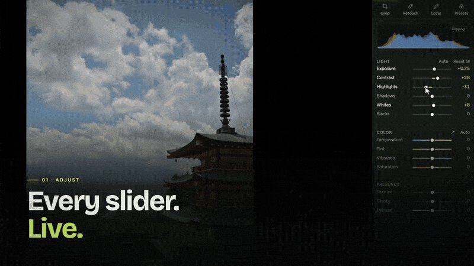
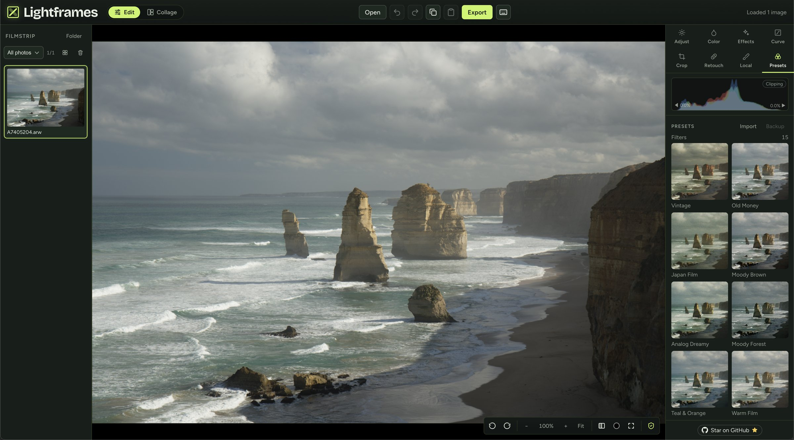
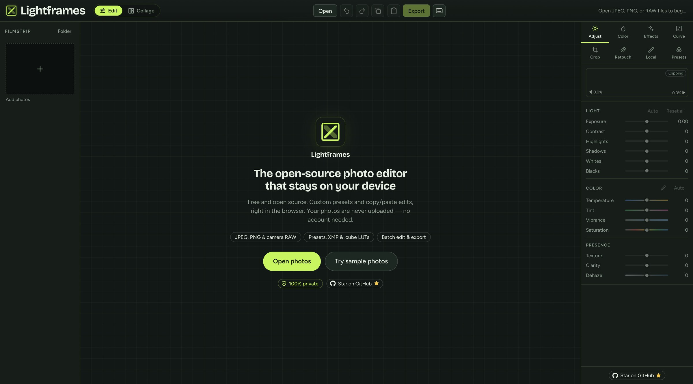
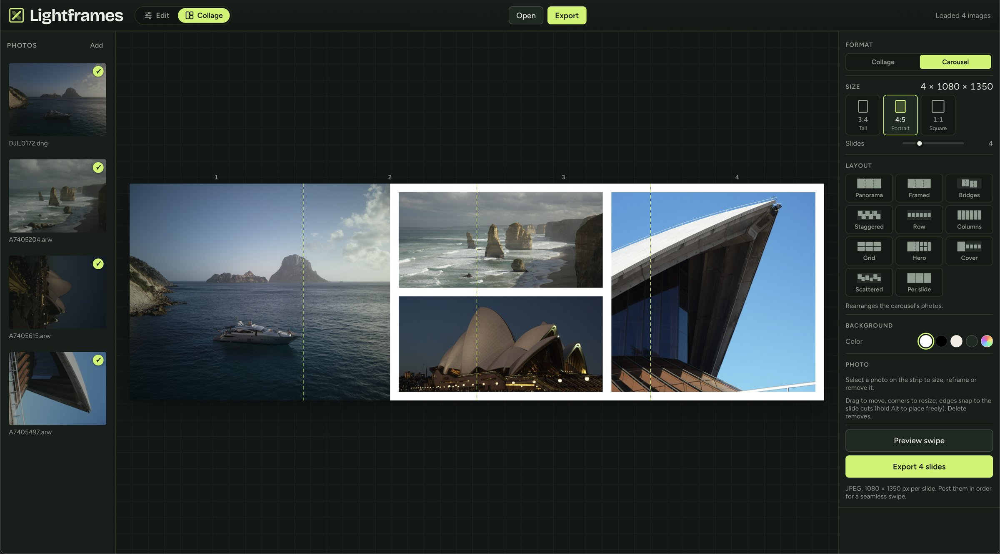
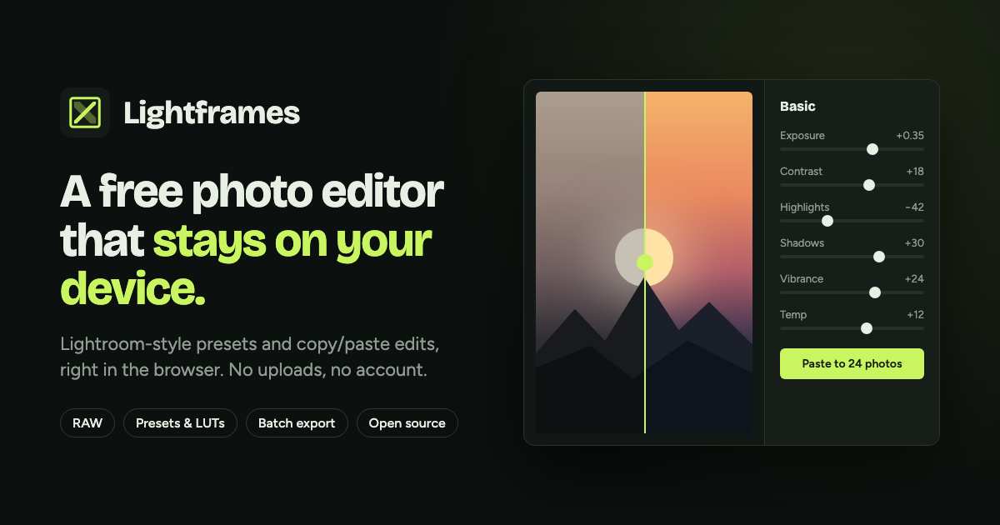

# Lightframes

**Use your Lightroom presets, without Lightroom.**

Apply your presets, XMP and `.cube` LUTs in batch and export an Instagram-ready carousel. Free, open source, in the browser. Nothing is uploaded.

**[Try it → lightframes.si](https://www.lightframes.si)** · [Open the editor](https://www.lightframes.si/editor) · [MIT license](./LICENSE)

Lightroom and Camera Raw are trademarks of Adobe. Lightframes is an independent project and is not affiliated with or endorsed by Adobe.

Your photos are opened, edited and exported in the browser. Nothing is uploaded.

The editor and the [gear page](https://www.lightframes.si/gear) include links to Amazon.es. As an Amazon Associate, Lightframes earns from qualifying purchases. The cards are drawings in the page: they do not load images or scripts from Amazon. Amazon is contacted only when you click a link.

## Demo

[](https://www.lightframes.si)

Fifteen seconds from the promo: sliders on an open photo, paste across the shoot, export, then presets (XMP and .cube LUTs). [MP4](docs/demo.mp4) if the GIF does not play.

The stills below are real screenshots.



| Start screen                                     | Carousel                                                                             |
| ------------------------------------------------ | ------------------------------------------------------------------------------------ |
|  |  |

Edits stay non-destructive until you export. Sessions restore from IndexedDB after a refresh. The app is an installable PWA. Editing works offline once it has loaded. The first use of object removal also downloads its model from Hugging Face.

## Features

- **RAW, JPEG and PNG.** RAW formats: ARW, CR2, CR3, NEF, NRW, DNG, RAF, ORF, RW2, PEF, SRW. Decoded in the browser with LibRaw (WebAssembly). The preview is a half-size decode; export develops the file again at full resolution. If the decode fails, the embedded JPEG is the fallback. **Open** uses the file picker; Filmstrip **Folder** opens a directory (Chromium). More opens append to the filmstrip.
- **Non-destructive edits.** Light, white balance (with a picker), texture, clarity, dehaze, HSL, effects, a master tone curve and per-channel curves, crop, straighten and rotate. Undo / redo, histogram, shadow/highlight clipping, and a before/after view of the whole image or a split.
- **Presets.** Save and update your own, set intensity from 0–100%, import and export JSON. Built-in looks ship with the app.
- **XMP.** `.xmp` develop presets (including Lightroom and Camera Raw) are mapped onto Lightframes sliders. What is imported: basic tone (exposure, contrast, highlights, shadows, whites, blacks), white balance (a relative temperature, or an approximation of Kelvin), tint, HSL, the tone curve (master and per channel), vibrance and saturation, texture, clarity, dehaze, colour grading (or the older split toning), vignette amount and midpoint, grain, sharpening, and luminance and colour noise reduction. What is **not** imported: camera profiles, lens corrections, local masks, crop and transform, calibration, and detail controls beyond those sliders. A preset that depends on the missing pieces will not match Lightroom.
- **LUTs.** `.cube` 3D LUTs, applied after the parametric edits.
- **Batch.** Copy / paste edits onto a selection (you choose which groups), or sync the active photo's edits. Several photos export as one ZIP.
- **Spot removal.** Heal and clone in the Retouch panel, plus on-device AI object removal (MI-GAN). The inpainting model is downloaded from Hugging Face the first time you use it, checked against a SHA-256, and cached. The photo is not uploaded with that download.
- **On-device AI.** Subject and background masks (IS-Net) for local adjustments and for background removal or replacement (transparency, a flat colour, or a blur), with a refine brush. Optional 2× / 4× upscale on export (Real-ESRGAN). The segmentation and upscale models are served from this site, not from a third party. Each model downloads once, is hash-checked, and then runs in the browser.
- **Local adjustments.** Linear, radial, brush and AI subject masks, including brightness and colour range limits.
- **Liquify.** A warp tool on its own panel.
- **Collage Studio.** Up to 9 photos on a slide, several aspect ratios (including 4:5, 1:1 and 3:4) and ready-made layouts.
- **Carousel Studio.** Seamless carousels of 2–10 slides, with ready-made layouts. The Instagram shapes (4:5, 1:1 and 3:4) export at 1080 px wide.
- **Export.** JPEG, PNG or WebP, with quality, a long edge up to 8192 px, a filename pattern and an optional text watermark.

## Quick start

Node.js 20+.

```bash
npm install
npm run dev
```

Open the URL Astro prints (usually `http://localhost:4321`). The landing page is `/`. The editor is `/editor`.

| Script            | What it does                                    |
| ----------------- | ----------------------------------------------- |
| `npm run dev`     | Dev server with hot reload                      |
| `npm run build`   | Type-check (`astro check`) and build to `dist/` |
| `npm run preview` | Serve the production build locally              |
| `npm run check`   | Type-check `.astro`, `.ts` and `.tsx` only      |
| `npm run lint`    | Lint with oxlint                                |

`dist/` is static files. Any static host can serve it. After the app has loaded, ordinary editing does not need a network. The first object removal downloads its model; see Offline use below. A Chromium browser (Chrome, Edge, Brave) is the best bet for opening a folder and for canvas performance. Large RAW files and the AI tools are slower on phones.

## Tech stack

- Astro static site (English and Spanish), React + TypeScript editor island
- Canvas preview: CPU pixel pipeline, dual-resolution scrubbing, Web Worker pool
- LibRaw compiled to WebAssembly for RAW
- ONNX Runtime Web for the AI models (WASM; WebGPU for upscale when the browser has it)
- IndexedDB for the session and presets, with a `localStorage` backup of presets
- Workbox service worker. Variable fonts (Bricolage Grotesque and Figtree) are self-hosted with `@fontsource-variable` and bundled into the site, so page load does not request Google Fonts
- MIT license

## Project structure

```
astro.config.mjs        site URL, integrations (React, sitemap, PWA)
integrations/pwa.mjs    writes dist/sw.js with workbox-build after the build
vercel.json             clean URLs, no trailing slash
src/
  App.tsx, components/, hooks/, lib/, types/   the editor (React)
  EditorRoot.tsx        editor entry, mounted by src/pages/editor.astro
  pages/                routes: landing, editor, tools, blog, FAQ, legal, robots.txt, llms.txt…
  site/                 layouts, i18n, JSON-LD, landing copy
  content/              tools, blog, pages, FAQ (Markdown / JSON, EN + ES)
public/                 icons, manifest, samples, AI models, site images
promo/                  promo video (Remotion), separate package
```

Tool pages, guides, the FAQ and the legal pages are Markdown or JSON in `src/content/`. See [docs/SEO.md](docs/SEO.md) for the URL map and how to add a post.

## Offline use and PWA

1. Open the production build once while online. The service worker precaches the app, including the LibRaw WASM and the self-hosted font files.
2. After that, open, edit, presets and export work without a network. In Chromium you can install it from the address bar.
3. The AI models and the ONNX runtime are not precached. Segmentation and upscale come from this site the first time you use them. Object removal downloads MI-GAN from Hugging Face the first time you use it. Each is cached after that.
4. The installed app starts at `/editor`.

## Shortcuts

Press `?` in the editor for the full list. Shortcuts are ignored while a text field is focused.

| Shortcut                          | Action                                     |
| --------------------------------- | ------------------------------------------ |
| `Ctrl/Cmd+Z`                      | Undo                                       |
| `Ctrl/Cmd+Shift+Z` / `Ctrl/Cmd+Y` | Redo                                       |
| `Ctrl/Cmd+C`                      | Copy edits                                 |
| `Ctrl/Cmd+V`                      | Paste edits to the selection               |
| `Ctrl/Cmd+A`                      | Select all in the filmstrip                |
| `Ctrl/Cmd+E`                      | Export dialog                              |
| `Shift+1`–`8`                     | Switch panel                               |
| `W`                               | White balance picker                       |
| `R`                               | Crop                                       |
| `Q`                               | Retouch: spots and background              |
| `M` / `Shift+M`                   | New linear / radial mask                   |
| `K` / `Shift+K`                   | New brush / AI subject mask                |
| `\`                               | Before (whole image)                       |
| `Y`                               | Before / after split                       |
| `J`                               | Clipping overlay                           |
| `G`                               | Show / hide filmstrip                      |
| `1`–`5` / `0`                     | Rate stars / clear rating                  |
| `P` / `X` / `U`                   | Pick / reject / unflag                     |
| `[` `]` or `↑` `↓`                | Previous / next photo                      |

## Contributing

Issues and pull requests are welcome. For anything larger than a small fix, open an issue first so the approach is agreed.

```bash
npm install
npm run lint
npm run build
```

Bug reports are most useful with the browser, the device, and, for RAW, the camera model. Please don't add a third-party script, font host, ad network or tracker: the privacy claim is that a page load stays on this origin, apart from the cases named in the privacy policy.

## License

MIT. See [LICENSE](./LICENSE).

Sample photos in `public/samples/` (and the preset renders made from them) are © the Lightframes author, all rights reserved. They are not covered by the MIT license. The AI models keep their own licenses (see `public/models/NOTICE.md`).

---

[](https://www.lightframes.si)

<p align="center">
  Your photos, your presets, your device.<br>
  <strong><a href="https://www.lightframes.si">Open Lightframes →</a></strong>
</p>
